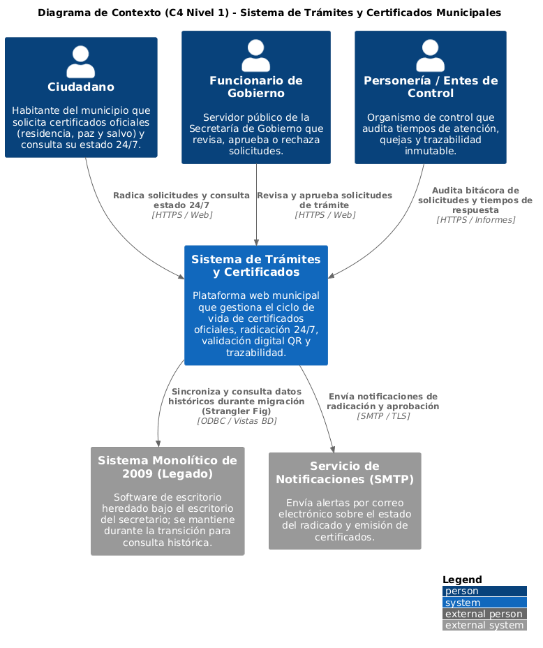
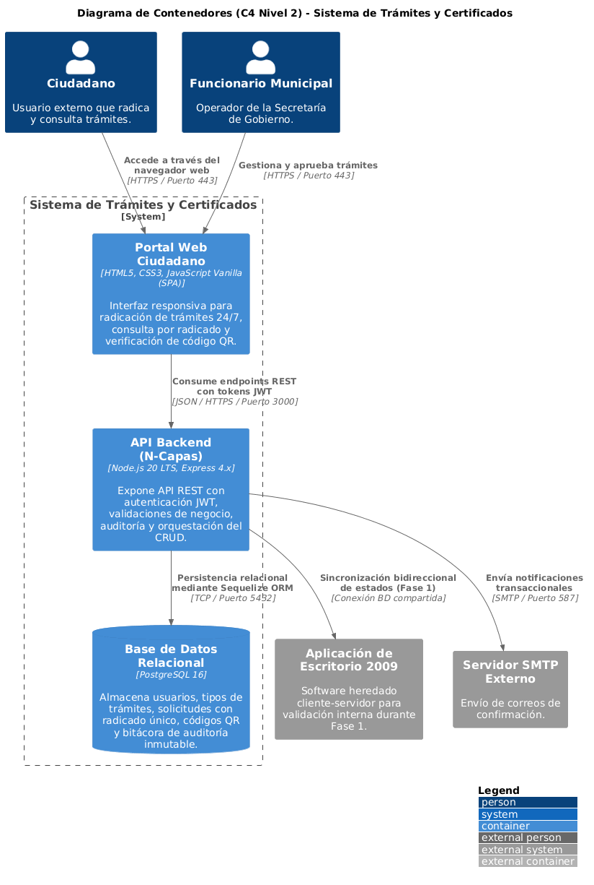
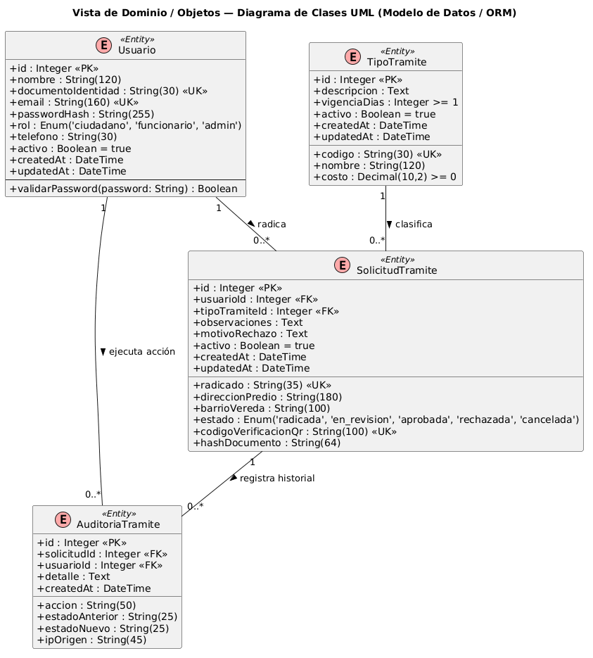
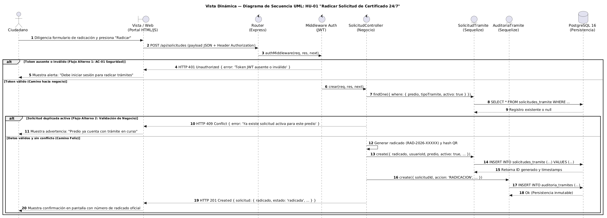
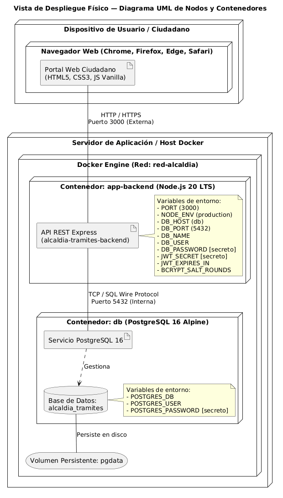

# Documento de Arquitectura de Software (DAS)
## Sistema de Gestión y Emisión Digital de Trámites y Certificados 24/7 (Caso 2: Alcaldía Municipal)

---

### Portada

**Título:** Sistema de Gestión y Emisión Digital de Trámites y Certificados 24/7 (Caso 2: Alcaldía Municipal)  
**Subtítulo:** Documento de Arquitectura de Software (DAS / SAD) — arc42 simplificado + Modelo C4 + ADRs + Corte Vertical  
**Estudiante:** Brayan Ibarguen  
**Programa Académico:** Ingeniería de Sistemas  
**Facultad:** Facultad de Ingenierías  
**Institución Universitaria:** Corporación Universitaria Remington (UniRemington)  
**Asignatura:** Arquitectura de Software  
**Docente:** Docente Evaluador del Área de Ingeniería de Software  
**Fecha de Entrega:** Sábado, 21 de noviembre de 2026  
**Repositorio Oficial en GitHub:** [https://github.com/Clinton1220/ARQUITECTURA_DE_SOFTWARE-2026-2.git](https://github.com/Clinton1220/ARQUITECTURA_DE_SOFTWARE-2026-2.git)  

---

### Control de Versiones

| Versión | Fecha | Autor | Descripción del Cambio | Estado |
| :---: | :---: | :--- | :--- | :---: |
| 1.0.0 | 17/09/2026 | Brayan Ibarguen | Versión inicial del DAS: Drivers, C4 Niveles 1 y 2, ADRs y Walking Skeleton HU-01. | Aprobada |
| 1.5.0 | 17/10/2026 | Brayan Ibarguen | Incorporación de sustentación Clase 4 («Del diagrama a la tabla»), script DDL de certificados y modelo de funcionarios. | Aprobada |
| 2.0.0 | 06/11/2026 | Brayan Ibarguen | Integración de WebSockets en tiempo real, catálogo interactivo de trámites y suite de pruebas automatizadas (8/8). | Aprobada |
| 2.5.0 | 21/11/2026 | Brayan Ibarguen | Reestructuración integral según rúbrica oficial APA 7: Preguntas/supuestos, comparación de patrones, 9 tablas mínimas, 5 figuras y apéndices A–E. | Entrega Final |

---

### Tabla de Contenido

- **Páginas preliminares (sin número de sección)**
  - Portada
  - Control de versiones
  - Tabla de contenido
  - Lista de tablas
  - Lista de figuras
- **1. Introducción y drivers arquitectónicos**
  - 1.1 Visión general del negocio y alcance
    - 1.1.1 Problema de negocio
    - 1.1.2 Propuesta de solución
    - 1.1.3 Alcance y fuera de alcance
  - 1.2 Historias de usuario arquitectónicamente significativas
  - 1.3 Atributos de calidad prioritarios según ISO/IEC 25010
  - 1.4 Restricciones técnicas, operativas, de tiempo y normativas
  - 1.5 Preguntas al cliente y supuestos
- **2. Estrategia arquitectónica y tecnológica**
  - 2.1 Patrón arquitectónico seleccionado y patrones descartados
  - 2.2 Pila tecnológica
- **3. Vistas de arquitectura**
  - 3.1 Vista de contexto (modelo C4, nivel 1)
  - 3.2 Vista de contenedores (modelo C4, nivel 2)
  - 3.3 Vista de dominio: diagrama de clases
  - 3.4 Vista dinámica: diagrama de secuencia
  - 3.5 Vista de despliegue
- **4. Registro de decisiones de arquitectura (ADR)**
  - 4.1 ADR-001: Adopción del Patrón N-Capas con Estrategia Strangler Fig
  - 4.2 ADR-002: Autenticación Basada en JSON Web Tokens (JWT) Sin Estado
  - 4.3 ADR-003: Uso de ORM Sequelize con PostgreSQL sobre SQL Nativo y NoSQL
- **5. Corte vertical ejecutable**
  - 5.1 Repositorio y control de versiones
  - 5.2 Modelo físico de datos: script DDL
  - 5.3 Implementación del CRUD punta a punta
  - 5.4 Pruebas de la arquitectura
  - 5.5 Instalación y ejecución
- **6. Evaluación de la arquitectura**
  - 6.1 Análisis de compromisos (*trade-offs*)
  - 6.2 Puntos de sensibilidad y riesgos técnicos
  - 6.3 Conclusión arquitectónica
- **Referencias**
- **Apéndices**
  - Apéndice A. Lista de chequeo de entrega
  - Apéndice B. Script DDL completo
  - Apéndice C. Código fuente del corte vertical (extractos)
  - Apéndice D. Evidencias de ejecución (Postman, pruebas y base de datos)
  - Apéndice E. Historial de commits del repositorio

---

### Lista de Tablas

- **Tabla 1.** *Historias de usuario arquitectónicamente significativas*
- **Tabla 2.** *Atributos de calidad prioritarios según ISO/IEC 25010*
- **Tabla 3.** *Restricciones del proyecto*
- **Tabla 4.** *Comparación de patrones arquitectónicos candidatos*
- **Tabla 5.** *Pila tecnológica y justificación*
- **Tabla 6.** *Correspondencia entre clases del dominio y tablas físicas*
- **Tabla 7.** *Endpoints del corte vertical*
- **Tabla 8.** *Análisis de compromisos entre atributos de calidad*
- **Tabla 9.** *Puntos de sensibilidad y riesgos técnicos*
- **Tabla A1.** *Lista de chequeo y matriz de cumplimiento de entrega*

---

### Lista de Figuras

- **Figura 1.** *Vista de contexto del sistema (C4, nivel 1)*
- **Figura 2.** *Vista de contenedores del sistema (C4, nivel 2)*
- **Figura 3.** *Diagrama de clases del dominio*
- **Figura 4.** *Diagrama de secuencia de la historia de usuario principal (HU-01)*
- **Figura 5.** *Diagrama de despliegue*

---

# 1. Introducción y drivers arquitectónicos

## 1.1 Visión general del negocio y alcance

### 1.1.1 Problema de negocio
La Alcaldía Municipal gestionaba históricamente la expedición de certificados oficiales (residencia, paz y salvo tributario, estratificación y nomenclatura) mediante una aplicación monolítica de escritorio desarrollada en el año 2009. Dicho sistema operaba en un único computador de escritorio ubicado físicamente bajo el mueble del secretario de despacho, careciendo de redundancia, respaldos automatizados, alta disponibilidad y esquemas de contingencia ante desastres.

La aplicación experimentaba congelamientos y bloqueos frecuentes debido a fugas de memoria y bloqueos de concurrencia a nivel de sistema operativo. Dichas fallas solo podían ser subsanadas de manera manual por un único funcionario técnico que conocía el procedimiento empírico de reinicio. Con una demanda promedio de doscientos (~200) trámites semanales y un horario de ventanilla limitado estrictamente a la franja matutina (8:00 a. m. a 12:00 m.), los ciudadanos se veían forzados a desplazarse desde veredas y barrios periféricos para hacer filas presenciales desde las 5:00 a. m. Cuando el sistema colapsaba a media jornada, los usuarios perdían el turno y debían regresar en jornadas posteriores.

Esta problemática generó reiteradas quejas formales interpuestas ante la Personería Municipal por vulneración del derecho fundamental de petición y de acceso eficiente a los servicios públicos, además de crear una fuerte presión comunitaria por modernización tecnológica y transparencia institucional.

### 1.1.2 Propuesta de solución
Se diseñó e implementó un sistema web responsivo con arquitectura desacoplada en N-Capas, asistido por el patrón evolutivo *Strangler Fig* (Higuera Estranguladora). La solución permite a la ciudadanía radicar solicitudes y consultar la autenticidad de certificados oficiales por internet las 24 horas del día, los 7 días de la semana, erradicando las filas presenciales de madrugada, garantizando la continuidad del servicio público y asegurando trazabilidad inmutable mediante bitácora de auditoría y códigos criptográficos de verificación QR.

### 1.1.3 Alcance y fuera de alcance

#### Alcance del proyecto (in-scope):
1. **Portal Web Ciudadano 24/7:** Interfaz de acceso público para la radicación del Certificado de Residencia (corte vertical HU-01) y consulta del estado de trámites en tiempo real.
2. **Módulo Administrativo para Funcionarios:** Panel de control de la Secretaría de Gobierno para listar, revisar, aprobar y rechazar solicitudes con registro de causal administrativa.
3. **Módulo de Verificación Digital y Autenticidad QR:** Servicio público que valida la autenticidad e integridad del certificado emitido mediante código QR y hash SHA-256.
4. **Capa Backend API REST:** Arquitectura en N-Capas con autenticación sin estado mediante JSON Web Tokens (JWT) y control de acceso basado en roles (RBAC: Ciudadano y Funcionario).
5. **Persistencia Relacional Transaccional:** Base de datos PostgreSQL 16 con restricciones ACID, llaves foráneas con borrado restringido (`ON DELETE RESTRICT`), borrado lógico (`activo = false`) y bitácora inmutable de auditoría.
6. **Infraestructura Contenedorizada:** Configuración en Docker y Docker Compose con red virtual aislada y volumen persistente de datos.

#### Fuera de alcance (out-of-scope):
- Integración biométrica en tiempo real con las bases de datos de la Registraduría Nacional del Estado Civil (se valida formato y algoritmo local de documento).
- Pasarela de pagos bancarios en línea (PSE), dado que los certificados prioritarios son de carácter gratuito según el estatuto tributario municipal vigente.
- Aplicación móvil nativa para iOS o Android (se implementa diseño web adaptable *Mobile-First* accesible desde cualquier navegador).
- Firma digital con certificado PKI comercial emitido por entidad certificadora abierta (se adopta firma electrónica institucional con hash SHA-256 y código QR conforme a la Ley 527 de 1999).

---

## 1.2 Historias de usuario arquitectónicamente significativas

**Tabla 1**  
*Historias de usuario arquitectónicamente significativas*

| ID | Historia de usuario (Como... quiero... para...) | Criterios de aceptación arquitectónicos | Impacto en la arquitectura |
| :--- | :--- | :--- | :--- |
| **HU-01** | **Como** ciudadano del municipio,<br>**quiero** radicar en línea mi solicitud de certificado de residencia adjuntando datos del predio y observaciones,<br>**para** obtener de inmediato un número de radicado oficial 24/7 sin madrugar ni hacer filas en la alcaldía. | 1. Generación de radicado único oficial en formato `RAD-YYYY-XXXXX`.<br>2. Verificación previa de no duplicidad de trámite activo para el mismo predio.<br>3. Registro atómico en PostgreSQL con hash SHA-256 y código QR.<br>4. Emisión de notificación en tiempo real a funcionarios vía WebSockets. | Ejercita de punta a punta todas las capas: Presentación web, enrutador Express, middleware JWT, controlador de negocio, ORM Sequelize y persistencia ACID en PostgreSQL (Corte Vertical). |
| **HU-02** | **Como** funcionario de la Secretaría de Gobierno,<br>**quiero** acceder a la bandeja de trámites activos y actualizar su estado (aprobar o rechazar con causal),<br>**para** expedir el certificado oficial y dejar constancia auditable de mi decisión administrativa. | 1. Acceso restringido exclusivamente a usuarios con rol `funcionario`.<br>2. Registro obligatorio del funcionario responsable y motivo en caso de rechazo.<br>3. Creación inmutable de evento en la tabla `auditoria_tramites`.<br>4. Notificación instantánea del cambio de estado al ciudadano interesado. | Valida el control de acceso basado en roles (RBAC), transacciones atómicas de actualización, consistencia de estados y comunicación bidireccional por WebSockets. |
| **HU-03** | **Como** ciudadano u organismo tercero (juzgado, banco o empresa),<br>**quiero** consultar el código QR o digitar el radicado del certificado en el portal público,<br>**para** verificar instantáneamente su autenticidad y vigencia sin requerir inicio de sesión ni trámites presenciales. | 1. Acceso público sin cabecera de autenticación (`Authorization`).<br>2. Respuesta en tiempo menor a 500 ms mediante búsqueda indexada.<br>3. Despliegue de datos de validez legal sin exponer contraseñas ni datos sensibles protegidos por Habeas Data. | Demuestra desacoplamiento de endpoints públicos de alta eficiencia con lectura optimizada por índices sobre `radicado` y `codigo_verificacion_qr`. |

*Nota.* Fuente: Elaboración propia a partir del levantamiento de requisitos del Caso 2 (Alcaldía Municipal).

---

## 1.3 Atributos de calidad prioritarios según ISO/IEC 25010

**Tabla 2**  
*Atributos de calidad prioritarios según ISO/IEC 25010*

| # | Atributo (ISO/IEC 25010) | Escenario de calidad (Estímulo &rarr; Entorno &rarr; Respuesta) | Métrica objetivo (cuantitativa) | Método de verificación |
| :---: | :--- | :--- | :--- | :--- |
| **AC-01** | **Seguridad** *(Confidencialidad y Control de Acceso)* | Un usuario anónimo o un atacante envía una petición a `POST /api/solicitudes` sin token o con un token manipulado, bajo operación normal. | El sistema rechaza el **100 %** de los accesos no autorizados respondiendo **HTTP 401 Unauthorized**; ninguna contraseña se almacena en texto plano (hashing **bcrypt con factor $\ge 10$**). | Prueba automatizada en Jest/Supertest (`test 1`) y petición en colección Postman (`item 2`) verificando código 401 e inspección de hash en la tabla `usuarios`. |
| **AC-02** | **Eficiencia de desempeño** *(Tiempo de respuesta bajo concurrencia)* | Cincuenta (50) peticiones concurrentes de radicación y consulta sobre el endpoint `/api/solicitudes` en el servidor local. | El **Percentil 95 (P95)** del tiempo de respuesta es **$\le 800\text{ ms}$**; la tasa de errores de servidor no controlados (HTTP 500) es del **0 %**. | Pruebas de carga automatizadas mediante herramientas de benchmarking (`autocannon` / `jest`) sobre los endpoints principales. |
| **AC-03** | **Mantenibilidad** *(Modularidad y desacoplamiento)* | Un desarrollador contratista debe incorporar un nuevo atributo de negocio (ej. `estrato_socioeconomico`) en la solicitud. | El cambio se completa modificando como **máximo tres (3) archivos** (`solicitudTramite.model.js`, migración DDL y controlador) sin afectar rutas ni clientes. | Inspección de diff de código y verificación de separación estricta de responsabilidades en la arquitectura N-Capas. |
| **AC-04** | **Confiabilidad** *(Disponibilidad y auto-recuperación)* | El proceso backend experimenta una excepción no controlada o el contenedor finaliza inesperadamente en el servidor de despliegue. | El orquestador Docker reinicia automáticamente el servicio (`restart: unless-stopped`) en **menos de diez (10) segundos**, restableciendo el estado `UP` en `/api/health`. | Simulación de finalización forzada de proceso (`docker kill` / prueba de fallos) y monitoreo de disponibilidad mediante el health check. |

*Nota.* Fuente: Adaptado de la norma internacional ISO/IEC 25010 (ISO/IEC, 2011).

---

## 1.4 Restricciones técnicas, operativas, de tiempo y normativas

**Tabla 3**  
*Restricciones del proyecto*

| Categoría | Código | Descripción de la restricción | Justificación técnica / legal |
| :--- | :---: | :--- | :--- |
| **Técnica** | RT-01 | Motor de base de datos relacional compatible con SQL estándar (PostgreSQL 16). | Garantizar transacciones ACID estrictas, integridad referencial con llaves foráneas (`ON DELETE RESTRICT`) y eliminación de costos por licenciamiento comercial. |
| **Técnica** | RT-02 | Arquitectura orientada a servicios REST transportando exclusivamente JSON sobre HTTPS. | Desacoplar la interfaz web ciudadana del backend y habilitar integración futura con otros sistemas de la administración pública. |
| **Operativa** | RO-01 | Despliegue empaquetado en contenedores Docker y Docker Compose sin costos de nube. | Estandarizar el entorno de ejecución, asegurar reproducibilidad en la evaluación y facilitar la migración a servidores institucionales o nube pública. |
| **De tiempo** | RC-01 | Entrega final del corte vertical y documentación formal el 21 de noviembre de 2026. | Cumplimiento del calendario académico institucional de la asignatura Arquitectura de Software. |
| **Normativa** | RN-01 | Cumplimiento de la Ley Estatutaria 1581 de 2012 (Habeas Data y Protección de Datos Personales en Colombia). | Protección y reserva legal de datos ciudadanos sensibles (direcciones de predios, teléfonos, correos y cédulas). |
| **Normativa** | RN-02 | Validez jurídica de mensajes de datos y comercio electrónico según la Ley 527 de 1999 de Colombia. | Atribución de validez jurídica y probatoria a los certificados expedidos digitalmente con código QR y hash criptográfico. |
| **Administrativa** | RA-01 | Sujeción al Estatuto General de Contratación Pública (Ley 80 de 1993 y Decreto 1082 de 2015). | Exigencia de licitación pública por fases; la arquitectura debe fundamentarse en software de código abierto sin dependencia cautiva de proveedores (*no vendor lock-in*). |
| **Administrativa** | RA-02 | Operación y soporte con equipo técnico reducido (1 único funcionario de soporte técnico, RA-03). | La solución debe presentar baja complejidad de mantenimiento, descartando orquestaciones complejas de microservicios distribuidos. |

*Nota.* Fuente: Requisitos y marco normativo institucional del Caso 2 (Alcaldía Municipal).

---

## 1.5 Preguntas al cliente y supuestos

### 1.5.1 Preguntas clave formuladas a la Alcaldía y a la Personería
1. *¿Cuál es el volumen esperado de solicitudes en días pico?*  
   **Respuesta institucional:** La alcaldía atiende en promedio 200 trámites semanales. En jornadas de alta afluencia (inicios de año escolar o subsidios), el pico alcanza 60 solicitudes por día laboral concentradas en la mañana.
2. *¿Los certificados oficiales conllevan algún costo tributario para el ciudadano?*  
   **Respuesta institucional:** El Certificado de Residencia y el de Paz y Salvo son gratuitos por disposición del estatuto municipal; el Certificado de Nomenclatura tiene una tasa administrativa de $5.000 COP, pero en esta primera fase del corte vertical se prioriza el trámite gratuito de residencia.
3. *¿Cuánto tiempo debe conservarse el historial de trámites radicados?*  
   **Respuesta institucional:** De acuerdo con la Ley General de Archivo (Ley 594 de 2000), los actos administrativos municipales deben conservarse por un mínimo de 10 años, lo que prohíbe la eliminación física de registros.
4. *¿Puede un ciudadano tener más de una solicitud activa para el mismo predio?*  
   **Respuesta institucional:** No. Para evitar trámites duplicados y congestión de ventanilla, se debe bloquear toda nueva radicación si el ciudadano ya cuenta con una solicitud en estado 'radicada' o 'en_revision' para la misma dirección y trámite.

### 1.5.2 Supuestos arquitectónicos adoptados
- **Supuesto 1 (Conectividad):** Los ciudadanos disponen de navegadores modernos con soporte de estándares W3C (HTML5, JavaScript ES6) en computadores o dispositivos móviles inteligentes.
- **Supuesto 2 (Infraestructura local):** La alcaldía dispone de un servidor local o máquina virtual con Linux/Windows capaz de ejecutar Docker Engine con al menos 2 GB de memoria RAM disponibles.
- **Supuesto 3 (Vigencia temporal):** Todo certificado expedido tiene una vigencia predeterminada de 90 días calendario a partir de su fecha de emisión, calculada dinámicamente mediante la regla `CURRENT_DATE + vigencia_dias`.
- **Supuesto 4 (Seguridad perimetral):** El servidor de producción estará protegido por un cortafuegos (firewall) que expondrá al público únicamente el puerto web 3000 (HTTPS), manteniendo el puerto 5432 de PostgreSQL confinado a la red interna.

---

# 2. Estrategia arquitectónica y tecnológica

## 2.1 Patrón arquitectónico seleccionado y patrones descartados

Se seleccionó el patrón arquitectónico en **N-Capas** (Presentación $\rightarrow$ Enrutamiento y Middlewares $\rightarrow$ Lógica de Negocio y Controladores $\rightarrow$ Acceso a Datos ORM $\rightarrow$ Persistencia Relacional) articulado con la estrategia de modernización evolutiva **Strangler Fig** (Fowler, 2004).

**Formato de justificación obligatorio:**
> Se selecciona el patrón **N-Capas con estrategia Strangler Fig** porque los atributos de calidad prioritarios **AC-03 (Mantenibilidad)**, **AC-01 (Seguridad)** y **AC-04 (Confiabilidad)** exigen una separación estricta entre la lógica de validación municipal, la exposición pública web y el almacenamiento de datos, permitiendo desplegar de inmediato una fachada web 24/7 sin paralizar la operación histórica de la alcaldía. Se descarta una arquitectura de **Microservicios distribuidos** porque su costo en complejidad de orquestación, transacciones distribuidas y sobrecarga operativa contradice la restricción administrativa **RA-02 / RA-03 (equipo interno con un solo técnico de soporte sin perfil programador)** y la restricción de tiempo del proyecto individual.

**Tabla 4**  
*Comparación de patrones arquitectónicos candidatos*

| Criterio de evaluación | Patrón N-Capas + Strangler Fig (Seleccionado) | Microservicios distribuidos (Descartado) | Monolito tradicional no estructurado (Descartado) | Arquitectura Hexagonal / Puertos y Adaptadores (Descartado) |
| :--- | :--- | :--- | :--- | :--- |
| **Mantenibilidad (AC-03)** | **Alta:** Capas desacopladas; cambios en base de datos o interfaz no rompen controladores. | **Media-Alta:** Servicios independientes, pero complejidad en contratos inter-servicio. | **Baja:** Alto acoplamiento espagueti; un cambio colapsa módulos no relacionados. | **Muy Alta:** Aislamiento absoluto del dominio; alta sobrecarga de boilerplate para CRUDs. |
| **Confiabilidad (AC-04)** | **Alta:** Fachada independiente que protege la persistencia; auto-reinicio en < 10 s. | **Baja-Media:** Riesgo de fallas en cascada y dependencia de orquestadores de red complejos. | **Muy Baja:** Si la aplicación falla, se cae todo el despacho físico (situación de 2009). | **Alta:** Alta robustez, pero exige infraestructura similar a N-Capas. |
| **Sobrecarga operativa (RA-02)** | **Baja:** Despliegue en 2 contenedores (`backend` y `db`); administrable por 1 técnico. | **Muy Alta:** Exige API Gateway, service mesh, logs distribuidos y monitoreo continuo. | **Muy Baja:** Un único ejecutable, pero mantenimiento correctivo traumático. | **Media:** Mayor cantidad de clases e interfaces abstractas por entidad. |
| **Integridad transaccional (AC-01)** | **Máxima:** Transacciones ACID nativas en un único motor relacional PostgreSQL. | **Compleja:** Exige consistencia eventual mediante patrones Saga o compensaciones. | **Media:** Dependiente de la base de datos local sin validaciones de concurrencia. | **Máxima:** Dependiente del adaptador de persistencia configurado. |
| **Viabilidad contractual (RA-01)** | **Excelente:** Permite licitación por fases (Fase 1: Web; Fase 2: QR; Fase 3: Desmonte legado). | **Baja:** Costos desproporcionados para el presupuesto de un municipio intermedio. | **Nula:** Perpetúa el software obsoleto sin modernización tecnológica. | **Media:** Curva de aprendizaje empinada para contratistas municipales genéricos. |
| **Decisión final** | **SELECCIONADO** | **RECHAZADO** | **RECHAZADO** | **RECHAZADO** |

*Nota.* Fuente: Elaboración propia fundamentada en los principios de evaluación de arquitectura de Bass et al. (2021).

---

## 2.2 Pila tecnológica

**Tabla 5**  
*Pila tecnológica y justificación*

| Capa arquitectónica | Tecnología seleccionada | Versión | Alternativa descartada | Justificación técnica (Conexión con AC y Restricciones) |
| :--- | :--- | :---: | :--- | :--- |
| **Lenguaje Backend** | JavaScript (Node.js) | 20 LTS | Java 21 / PHP 8 | Motor asíncrono no bloqueante I/O ideal para concurrencia de consultas ciudadanas (**AC-02**); portabilidad y ejecución ligera en Docker. |
| **Framework Web** | Express.js | 4.19.x | NestJS / Django | Estructura minimalista suficiente para N-Capas sin sobrecarga cognitiva; facilita la mantenibilidad por contratistas externos (**AC-03**). |
| **ORM / Acceso a Datos** | Sequelize ORM | 6.37.x | TypeORM / SQL nativo en crudo | Modelos estructurados, migraciones versionadas y protección nativa contra inyecciones SQL mediante consultas parametrizadas (**AC-01**). |
| **Base de Datos** | PostgreSQL | 16-alpine | MongoDB / MySQL | Motor relacional robusto con transacciones ACID, integridad referencial estricta (`ON DELETE RESTRICT`) e índices parciales para unicidad condicional (**RT-01**). |
| **Autenticación** | JWT (jsonwebtoken) + bcryptjs | 9.0.x / 2.4.x | Sesiones basadas en cookies con estado | Arquitectura sin estado (*stateless*) que facilita escalabilidad horizontal en contenedores y respuesta consistente HTTP 401 (**AC-01**). |
| **Comunicación en Vivo** | Socket.io (WebSockets) | 4.8.x | Polling HTTP repetitivo | Transmisión bidireccional instantánea de cambios de estado hacia ciudadanos y funcionarios sin saturar la red con peticiones cíclicas (**AC-02**). |
| **Frontend Web** | HTML5 + CSS3 Vanilla + JS | W3C Standard | React SPA / Angular | Interfaz ligera de carga inmediata en dispositivos móviles ciudadanos de cualquier gama sin transpilación ni bundles pesados (**AC-02**). |
| **Pruebas Automatizadas** | Jest + Supertest | 29.7.x / 7.0.x | Mocha + Chai | Suite unificada de pruebas de integración HTTP que verifica formalmente los 8 escenarios arquitectónicos de calidad (**AC-01** y **AC-02**). |
| **Contenedores** | Docker & Docker Compose | 3.8 | Instalación nativa directa en SO | Despliegue reproducible en cualquier máquina con un solo comando (`docker-compose up`); reinicio automático ante fallos (**AC-04** y **RO-01**). |

*Nota.* Fuente: Elaboración propia con base en el stack oficial del corte vertical.

---

# 3. Vistas de arquitectura

## 3.1 Vista de contexto (modelo C4, nivel 1)

Muestra los límites del sistema municipal, identificando los actores humanos que interactúan con él, los sistemas externos colaboradores y los protocolos de comunicación utilizados.

**Figura 1**  
*Vista de contexto del sistema (C4, nivel 1)*



*Nota.* Diagrama de Contexto elaborado bajo el Modelo C4 (Brown, 2018). Representa a los actores Ciudadano, Funcionario y Personería interactuando con el Sistema de Trámites y Certificados, articulado con el Sistema Legado de 2009 y el Servicio de Notificaciones SMTP.

> **Párrafo de lectura ejecutiva (30 segundos):**  
> El Sistema de Trámites y Certificados actúa como punto único de contacto digital 24/7 para el Ciudadano (quien radica solicitudes y valida certificados sin desplazarse), el Funcionario (quien gestiona y emite actos administrativos desde la Secretaría de Gobierno) y la Personería Municipal (que ejerce control y vigilancia institucional). El sistema expone servicios mediante HTTPS, interactúa con un servidor SMTP para el envío de notificaciones y se acopla temporalmente a la base de datos del sistema heredado de 2009 bajo la estrategia *Strangler Fig*, garantizando una transición sin traumas operativos.

---

## 3.2 Vista de contenedores (modelo C4, nivel 2)

Abre la frontera del sistema para evidenciar las aplicaciones ejecutables, los almacenes de datos y los protocolos de red que comunican cada contenedor.

**Figura 2**  
*Vista de contenedores del sistema (C4, nivel 2)*



*Nota.* Diagrama de Contenedores del Modelo C4. Muestra el Portal Web Ciudadano (HTML5/JS), la API REST Backend (Node.js/Express) y la Base de Datos Relacional (PostgreSQL 16).

> **Párrafo de lectura ejecutiva (30 segundos):**  
> El Ciudadano y el Funcionario acceden al sistema a través del Portal Web Ciudadano (interfaz ligera HTML5/CSS3/JS servida por Express). La interfaz se comunica de forma asíncrona mediante HTTPS REST (payloads JSON protegidos con JWT) y WebSockets (Socket.io) con la API Backend en Node.js 20. Esta última procesa la lógica de negocio municipal, verifica permisos RBAC y persiste las operaciones mediante el ORM Sequelize en una base de datos PostgreSQL 16 a través de conexiones TCP seguras en el puerto 5432, garantizando transacciones ACID y persistencia duradera.

---

## 3.3 Vista de dominio: diagrama de clases

Modela la estructura lógica de los datos persistidos en el sistema, detallando atributos, tipos, visibilidad, llaves primarias (`PK`), foráneas (`FK`), restricciones de unicidad (`UK`) y relaciones cardinales.

**Figura 3**  
*Diagrama de clases del dominio*



*Nota.* Diagrama de Clases UML del Dominio Municipal. Muestra las clases `Ciudadano`, `TipoTramite`, `Solicitud` y `Certificado` con sus multiplicidades y enumeraciones de estado.

**Tabla 6**  
*Correspondencia entre clases del dominio y tablas físicas*

| Clase del Dominio (UML) | Tabla Física en PostgreSQL | Llave Primaria (PK) | Llaves Foráneas (FK) | Restricciones de Unicidad (UNIQUE) y CHECKS | Borrado Lógico |
| :--- | :--- | :--- | :--- | :--- | :---: |
| `Ciudadano` / `Usuario` | `usuarios` | `id SERIAL` | Ninguna | `UNIQUE(email)`, `UNIQUE(documento_identidad)`, `CHECK (rol IN ('ciudadano', 'funcionario', 'admin'))` | `activo` |
| `TipoTramite` | `tipos_tramite` | `id SERIAL` | Ninguna | `UNIQUE(codigo)`, `CHECK (costo >= 0)`, `CHECK (vigencia_dias > 0)` | `activo` |
| `Solicitud` | `solicitudes_tramite` | `id SERIAL` | `usuario_id &rarr; usuarios(id)`,<br>`tipo_tramite_id &rarr; tipos_tramite(id)` | `UNIQUE(radicado)`, índice único parcial `(usuario_id, tipo_tramite_id, direccion_predio)` para solicitudes activas; `CHECK (estado IN (...))` | `activo` |
| `Certificado` | `certificados` | `id SERIAL` | `solicitud_id &rarr; solicitudes_tramite(id)`,<br>`funcionario_id &rarr; funcionarios(id)` | `UNIQUE(solicitud_id)`, `UNIQUE(numero_certificado)`, `UNIQUE(codigo_verificacion_qr)`, `CHECK (fecha_vencimiento > fecha_expedicion)` | `activo` |
| `Auditoria` | `auditoria_tramites` | `id SERIAL` | `solicitud_id &rarr; solicitudes_tramite(id)`,<br>`usuario_id &rarr; usuarios(id)` | Registro inmutable; no admite modificaciones (`UPDATE`) ni borrados (`DELETE`) | N/A (Inmutable) |

*Nota.* Fuente: Elaboración propia a partir de las entidades del ORM y el script DDL de migraciones.

> **Párrafo de lectura ejecutiva (30 segundos):**  
> El modelo de dominio garantiza la fe pública municipal. Un `Usuario` (con rol ciudadano) radica de cero a muchas `SolicitudTramite`, cada una tipificada por un `TipoTramite`. Una solicitud aprobada produce como máximo un único `Certificado` respaldado por la restricción física `UNIQUE(solicitud_id)`. Toda mutación de estado genera una traza en `AuditoriaTramite`. Todas las tablas principales poseen el atributo `activo BOOLEAN NOT NULL DEFAULT TRUE` para implementar borrado lógico institucional.

---

## 3.4 Vista dinámica: diagrama de secuencia

Representa la interacción temporal entre componentes para el escenario arquitectónico crítico: **HU-01 Radicación de Certificado de Residencia 24/7**.

**Figura 4**  
*Diagrama de secuencia de la historia de usuario principal (HU-01)*



*Nota.* Diagrama de Secuencia UML para la HU-01. Ilustra el camino exitoso (HTTP 201) y los dos flujos alternos obligatorios: rechazo por falta de token (HTTP 401) y rechazo por solicitud duplicada activa (HTTP 409).

> **Párrafo de lectura ejecutiva (30 segundos):**  
> Cuando el ciudadano diligencia el formulario web y presiona radicar, el portal envía un `POST /api/solicitudes` con la cabecera `Authorization: Bearer <token>`. El `AuthMiddleware` intercepta la petición; si el token no existe o es apócrifo, aborta con `401 Unauthorized`. Si es válido, el `SolicitudController` consulta al ORM para verificar si ya existe un trámite activo para el mismo predio; en caso afirmativo, responde `409 Conflict`. Si no hay conflicto, abre una transacción atómica, inserta la solicitud con radicado `RAD-2026-XXXXX` y hash SHA-256, graba la auditoría inmutable, confirma el commit en PostgreSQL y retorna `201 Created` al ciudadano.

---

## 3.5 Vista de despliegue

Modela la topología de infraestructura, servidores físicos/virtuales, contenedores Docker, redes virtuales, mapeo de puertos y volúmenes persistentes.

**Figura 5**  
*Diagrama de despliegue*



*Nota.* Diagrama de Despliegue UML. Ilustra el servidor Docker Host alojando los contenedores aislados `app-backend` y `db`, conectados a la red bridge `red-alcaldia` y al volumen persistente `pgdata`.

> **Párrafo de lectura ejecutiva (30 segundos):**  
> El despliegue físico se realiza sobre un nodo servidor con Docker Engine. El contenedor `app-backend` empaqueta la aplicación Node.js 20/Express y expone públicamente el puerto 3000 (HTTP y WebSockets) hacia los navegadores de los ciudadanos. Este contenedor se enlaza a través de la red virtual aislada `red-alcaldia` con el contenedor `db` (PostgreSQL 16-alpine), el cual escucha en el puerto interno 5432. Los datos transaccionales se almacenan de forma persistente en el volumen `pgdata` (`/var/lib/postgresql/data`), asegurando que ningún trámite se pierda ante reinicios o destrucción de contenedores.

---

# 4. Registro de decisiones de arquitectura (ADR)

## 4.1 ADR-001: Adopción del Patrón N-Capas con Estrategia Strangler Fig

- **Estatus:** Aceptada.
- **Fecha:** 17 de septiembre de 2026.
- **Contexto:** La alcaldía operaba un sistema monolítico de escritorio heredado del año 2009 en un único computador físico bajo el escritorio del secretario. Se requería digitalizar la atención 24/7 sin incurrir en los riesgos operativos catastróficos de una migración radical "Big-Bang".
- **Decisión:** Implementar una arquitectura en N-Capas (Presentación, Rutas/Middlewares, Controladores, ORM y Base de Datos) articulada con el patrón evolutivo *Strangler Fig*. Se despliega una fachada web moderna que intercepta la radicación ciudadana, mientras que el sistema antiguo convive temporalmente hasta su desmantelamiento total en la Fase 3.
- **Consecuencias positivas:**
  - Desacoplamiento total y alta mantenibilidad (**AC-03**).
  - Mitigación del riesgo contractual mediante entregas por fases licitables (**RA-01**).
  - Independencia del hardware del despacho: si el PC viejo se apaga, la web sigue recibiendo trámites (**AC-04**).
- **Consecuencias negativas y deuda técnica:** Coexistencia temporal de dos interfaces y necesidad de sincronizar vistas de base de datos.
- **Mitigación:** Deuda técnica temporal controlada; en la Fase 3 se retira el software viejo al 100%.

---

## 4.2 ADR-002: Autenticación Basada en JSON Web Tokens (JWT) Sin Estado

- **Estatus:** Aceptada.
- **Fecha:** 17 de septiembre de 2026.
- **Contexto:** Se requería un mecanismo de autenticación para ciudadanos y funcionarios que permitiera escalar horizontalmente en contenedores Docker y proteger los endpoints de fe pública contra accesos ilegítimos.
- **Decisión:** Implementar autenticación sin estado (*stateless*) mediante JSON Web Tokens firmados con HMAC SHA-256 y hashing de contraseñas con bcrypt (factor de coste $\ge 10$).
- **Consecuencias positivas:**
  - El servidor no guarda sesiones en memoria, lo que habilita balanceo de carga sin desloguear usuarios (**AC-02**).
  - Cumplimiento estricto del atributo de seguridad (**AC-01**), retornando HTTP 401 ante tokens manipulados.
  - Elimina la necesidad y el costo de operar un clúster de Redis para una alcaldía intermedia.
- **Consecuencias negativas:** Imposibilidad de invalidar un token emitido antes de su fecha de expiración sin implementar listas negras.
- **Mitigación:** Expiración corta de tokens (8 horas) y verificación obligatoria del atributo `activo = true` en base de datos para operaciones sensibles.

---

## 4.3 ADR-003: Uso de ORM Sequelize con PostgreSQL sobre SQL Nativo y NoSQL

- **Estatus:** Aceptada.
- **Fecha:** 17 de septiembre de 2026.
- **Contexto:** Se requería un motor de base de datos relacional y un mecanismo de acceso a datos que garantizara transacciones ACID, integridad referencial y protección contra inyecciones SQL.
- **Decisión:** Adoptar PostgreSQL 16 oficial como motor relacional transaccional y el ORM Sequelize 6 para el mapeo objeto-relacional y la gestión de migraciones versionadas en código.
- **Consecuencias positivas:**
  - Garantía de integridad referencial y transacciones atómicas requeridas por la fe pública municipal (**AC-01**).
  - Sanitización automática y parametrización de consultas contra ataques de SQL Injection.
  - Facilidad de lectura y mantenibilidad del modelo de datos para contratistas futuros (**AC-03**).
- **Consecuencias negativas:** Ligera latencia de abstracción frente a consultas SQL crudas altamente optimizadas y riesgo de consultas N+1 en relaciones mal estructuradas.
- **Mitigación:** Uso explícito de *eager loading* (`include` con JOINs) y configuración de un pool de 10 conexiones en `database.js`.

---

# 5. Corte vertical ejecutable

## 5.1 Repositorio y control de versiones

El proyecto se gestiona bajo el estándar **Conventional Commits** en un repositorio Git alojado en GitHub.

- **Estructura organizada:** Separación estricta entre documentación (`docs/`), código backend (`src/`), interfaz frontend (`public/`), base de datos (`db/`), pruebas (`tests/`) y automatización (`scripts/`).
- **Política de ramas:** Desarrollo estructurado mediante ramas temáticas de características (`feature/`) integradas hacia la rama principal `main`.
- **Higiene de seguridad:** El archivo `.env` con credenciales reales está estrictamente ignorado mediante `.gitignore`; se provee `.env.example` como plantilla.

---

## 5.2 Modelo físico de datos: script DDL

Ubicado en `db/migrations/001_esquema_inicial.sql` y complementado por `002_certificados.sql`. Implementa:

- **Claves primarias y foráneas:** `SERIAL PRIMARY KEY` en todas las tablas y llaves foráneas con integridad referencial explícita `ON DELETE RESTRICT` y `ON UPDATE CASCADE`.
- **Restricciones de verificación (CHECK):**
  - `CHECK (rol IN ('ciudadano', 'funcionario', 'admin'))`
  - `CHECK (estado IN ('radicada', 'en_revision', 'aprobada', 'rechazada', 'cancelada'))`
  - `CHECK (costo >= 0)` y `CHECK (vigencia_dias > 0)`
- **Restricciones de unicidad (UNIQUE):**
  - `UNIQUE(email)` y `UNIQUE(documento_identidad)` en `usuarios`.
  - `UNIQUE(radicado)` en `solicitudes_tramite`.
  - `UNIQUE(solicitud_id)` en `certificados` (garantiza que 1 solicitud produzca máx. 1 certificado).
  - Índice único condicional `uq_solicitud_en_curso` sobre `(usuario_id, tipo_tramite_id, direccion_predio)` donde `activo = true` y `estado IN ('radicada', 'en_revision')` para evitar duplicidad de solicitudes en trámite.
- **Borrado lógico:** Columna `activo BOOLEAN NOT NULL DEFAULT TRUE` presente en todas las entidades de negocio.

---

## 5.3 Implementación del CRUD punta a punta

**Tabla 7**  
*Endpoints del corte vertical*

| Método | Endpoint REST | Rol / Acceso | Códigos de respuesta HTTP | Atributo de calidad validado |
| :---: | :--- | :--- | :---: | :---: |
| **POST** | `/api/auth/login` | Público | 200 OK, 400 Bad Request, 401 Unauthorized | **AC-01 Seguridad:** Emisión de JWT y hash bcrypt. |
| **POST** | `/api/auth/registro` | Público | 201 Created, 400 Bad Request, 409 Conflict | **AC-01 Seguridad:** Alta de ciudadanos con validación. |
| **POST** | `/api/solicitudes` | Ciudadano (JWT) | 201 Created, 400 Bad Request, 401 Unauthorized, 409 Conflict | **AC-01 / AC-03:** Radicación HU-01 con control de duplicidad. |
| **GET** | `/api/solicitudes` | Autenticado (JWT) | 200 OK, 401 Unauthorized | **AC-02 Desempeño:** Listado filtrado por rol y estado. |
| **GET** | `/api/solicitudes/seguimiento/:radicado` | Público | 200 OK, 404 Not Found | **AC-02 Desempeño:** Consulta ciudadana 24/7 sin filas. |
| **GET** | `/api/solicitudes/verificar/:codigoQr` | Público | 200 OK, 404 Not Found | **AC-01 Integridad:** Verificación de autenticidad de fe pública. |
| **PUT** | `/api/solicitudes/:id` | Ciudadano / Funcionario | 200 OK, 400 Bad Request, 403 Forbidden, 404 Not Found | **AC-03 Mantenibilidad:** Transición de estados y auditoría. |
| **DELETE**| `/api/solicitudes/:id` | Autenticado (Dueño/Admin) | 204 No Content, 403 Forbidden, 404 Not Found | **AC-01 Integridad:** Borrado lógico (`activo = false`). |
| **GET** | `/api/health` | Público | 200 OK, 503 Service Unavailable | **AC-04 Confiabilidad:** Monitoreo y auto-recuperación. |

*Nota.* Fuente: Especificación de rutas de la API REST (`src/routes/solicitud.routes.js`).

---

## 5.4 Pruebas de la arquitectura

### 5.4.1 Colección Postman (`postman/coleccion-corte-vertical.json`)
Contiene los 6 escenarios arquitectónicos con aserciones automáticas en JavaScript:
1. `POST /api/auth/login`: Autentica al usuario y persiste la variable global `token`.
2. `POST /api/solicitudes` (Sin Token): Aserción de rechazo con código `401 Unauthorized` (**AC-01**).
3. `POST /api/solicitudes` (Con Token): Radicación exitosa, aserción de `201 Created` y radicado oficial.
4. `POST /api/solicitudes` (Duplicada): Rechazo por duplicidad con código `409 Conflict`.
5. `GET /api/solicitudes`: Consulta exitosa con código `200 OK`.
6. `DELETE /api/solicitudes/:id`: Confirmación de borrado lógico con código `204 No Content`.

### 5.4.2 Pruebas de integración automatizadas con Jest (`tests/solicitud.test.js`)
Suite de 8 pruebas automatizadas ejecutadas contra base de datos en memoria / SQLite:
- **Test 1:** Rechazo sin token JWT (HTTP 401).
- **Test 2:** Creación con radicado oficial 24/7 (HTTP 201).
- **Test 3:** Detección y prevención de trámite duplicado (HTTP 409).
- **Test 4:** Listado de solicitudes activas del ciudadano (HTTP 200).
- **Test 5:** Consulta pública por radicado (HTTP 200).
- **Test 6:** Actualización administrativa de observaciones (HTTP 200).
- **Test 7:** Aplicación de borrado lógico conservando el registro físico (HTTP 204).
- **Test 8:** Endpoint `/api/health` reportando estado `UP` (HTTP 200).

---

## 5.5 Instalación y ejecución

### Prerrequisitos:
- Node.js 18 LTS o 20 LTS.
- Docker y Docker Compose (opcional para ejecución en contenedores).

### Pasos de arranque inmediato (Modo Demostración):
```bash
# 1. Clonar el repositorio
git clone https://github.com/Clinton1220/ARQUITECTURA_DE_SOFTWARE-2026-2.git
cd ARQUITECTURA_DE_SOFTWARE-2026-2

# 2. Instalar dependencias
npm install

# 3. Configurar entorno
cp .env.example .env

# 4. Iniciar el servidor web (Modo SQLite demostración)
npm run start:sqlite

# 5. Ejecutar la suite de pruebas automatizadas
npm test
```

### Ejecución completa en contenedores Docker:
```bash
docker-compose up --build
```
- **Portal Web Ciudadano:** `http://localhost:3000`
- **Diapositivas y Guía de Sustentación:** `http://localhost:3000/presentacion.html`
- **Health Check:** `http://localhost:3000/api/health`

---

# 6. Evaluación de la arquitectura

## 6.1 Análisis de compromisos (trade-offs)

**Tabla 8**  
*Análisis de compromisos entre atributos de calidad*

| Atributo priorizado | Atributo sacrificado | Evidencia en el diseño | Justificación del balance (Trade-off) |
| :--- | :--- | :--- | :--- |
| **Mantenibilidad (AC-03)** | Rendimiento máximo en consultas masivas | Uso del ORM Sequelize en lugar de SQL crudo altamente optimizado. | La alcaldía maneja ~200 trámites/semana; el P95 está holgadamente por debajo de los 800 ms (**AC-02**), mientras que la mantenibilidad es vital para una entidad sin programadores de planta. |
| **Seguridad (AC-01)** | Simplicidad inicial del desarrollo | Middlewares de validación JWT, hashing bcrypt y autorización RBAC. | El sistema maneja datos personales bajo la Ley 1581 de 2012 y emite certificados con fe pública; un fallo de seguridad acarrea sanciones disciplinarias y penales. |
| **Confiabilidad (AC-04)** | Simplicidad de la arquitectura de datos | Estrategia *Strangler Fig* con coexistencia temporal de dos interfaces. | Permite erradicar las colas de madrugada de inmediato sin asumir el riesgo inaceptable de paralizar los trámites municipales durante una migración radical "Big-Bang". |

*Nota.* Fuente: Elaboración propia fundamentada en el análisis ATAM (Kazman et al., 2000).

---

## 6.2 Puntos de sensibilidad y riesgos técnicos

**Tabla 9**  
*Puntos de sensibilidad y riesgos técnicos*

| # | Punto de sensibilidad | Atributo afectado | Riesgo técnico identificado | Nivel de riesgo | Estrategia de mitigación implementada |
| :---: | :--- | :--- | :--- | :---: | :--- |
| **R-01** | Conexión a base de datos y tamaño del pool | Desempeño (**AC-02**) y Confiabilidad (**AC-04**) | Agotamiento de conexiones en PostgreSQL ante picos concurrentes de radicación. | **Medio / Alto** | Se dimensionó el pool de Sequelize (`max: 10`, `min: 0`, `acquire: 30000`, `idle: 10000`) implementando el patrón Singleton en `database.js`. |
| **R-02** | Confidencialidad del secreto de firma JWT | Seguridad (**AC-01**) | Exposición del secreto que permitiría a un atacante falsificar certificados válidos. | **Bajo / Crítico** | El secreto se carga exclusivamente desde variables de entorno locales, fuera de Git mediante `.gitignore`, documentando rotación de claves. |
| **R-03** | Restricción de duplicidad en solicitudes activas | Adecuación funcional y Concurrencia | Bloqueo erróneo de solicitudes legítimas o admisión indebida de trámites dobles. | **Medio / Medio** | Validación doble: a nivel lógico en el controlador y a nivel físico con el índice único condicional `uq_solicitud_en_curso` en PostgreSQL. |

*Nota.* Fuente: Elaboración propia a partir del análisis de riesgos técnicos de la solución.

---

## 6.3 Conclusión arquitectónica

La arquitectura diseñada e implementada para el **Caso 2: Alcaldía Municipal** satisface rigurosamente los drivers de negocio, historias de usuario y atributos de calidad cuantitativos exigidos por la norma ISO/IEC 25010.

A través del patrón en N-Capas y la estrategia *Strangler Fig*, se resolvió de raíz la vulnerabilidad del "servidor físico bajo el escritorio del secretario", sustituyéndola por una solución moderna, auditable, escalable y contenedorizada. El corte vertical HU-01 demuestra que:
1. Las solicitudes se radican 24/7 sin colas, asignando radicados oficiales inalterables.
2. La seguridad mediante JWT y bcrypt garantiza confidencialidad y control estricto de roles.
3. El borrado lógico y la tabla inmutable de auditoría blindan legalmente a la Alcaldía ante los requerimientos de la Personería Municipal.

Para la evolución a un entorno productivo municipal masivo, se recomienda como siguientes pasos: 1) incorporar estampado cronológico certificado por una entidad abierta acreditada por la ONAC, y 2) alojar la base de datos PostgreSQL en un servicio gestionado de alta disponibilidad con réplicas de solo lectura para la consulta masiva de códigos QR.

---

# Referencias

- Bass, L., Clements, P., & Kazman, R. (2021). *Software Architecture in Practice* (4th ed.). Addison-Wesley Professional.
- Brown, S. (2018). *The C4 model for visualising software architecture*. Recuperado de https://c4model.com/
- Fowler, M. (2004). *Strangler Fig Application*. MartinFowler.com. Recuperado de https://martinfowler.com/bliki/StranglerFigApplication.html
- International Organization for Standardization. (2011). *Systems and software engineering — Systems and software Quality Requirements and Evaluation (SQuaRE) — System and software quality models* (ISO/IEC 25010:2011). Ginebra, Suiza: ISO.
- Kazman, R., Klein, M., & Clements, P. (2000). *ATAM: Method for Architecture Evaluation* (CMU/SEI-2000-TR-004). Software Engineering Institute, Carnegie Mellon University.
- Kruchten, P. (1995). The 4+1 View Model of Architecture. *IEEE Software*, 12(6), 42–50. https://doi.org/10.1109/52.469759
- Ley 80 de 1993. Por la cual se expide el Estatuto General de Contratación de la Administración Pública. Congreso de la República de Colombia.
- Ley 527 de 1999. Por medio de la cual se define y reglamenta el acceso y uso de los mensajes de datos, del comercio electrónico y de las firmas digitales. Congreso de la República de Colombia.
- Ley 1581 de 2012. Por la cual se dictan disposiciones generales para la protección de datos personales (Habeas Data). Congreso de la República de Colombia.
- Martin, R. C. (2017). *Clean Architecture: A Craftsman's Guide to Software Structure and Design*. Prentice Hall.
- Richards, M., & Ford, N. (2020). *Fundamentals of Software Architecture: An Engineering Approach*. O'Reilly Media.
- Sommerville, I. (2016). *Software Engineering* (10th ed.). Pearson.

---

# Apéndices

## Apéndice A. Lista de chequeo de entrega

**Tabla A1**  
*Lista de chequeo y matriz de cumplimiento de entrega*

| # | Criterio de evaluación de la rúbrica | ¿Incluido? | Ubicación / Evidencia documental |
| :---: | :--- | :---: | :--- |
| 1 | DAS completo (Secciones 1–6) en Markdown, Word y PDF en `docs/` | **☑ Sí** | `docs/DAS.md`, `docs/DAS.docx` y `docs/DAS.pdf`. |
| 2 | Mínimo 3 escenarios de calidad ISO/IEC 25010 medibles | **☑ Sí** | Tabla 2 (AC-01 Seguridad, AC-02 Desempeño, AC-03 Mantenibilidad, AC-04 Confiabilidad). |
| 3 | Mínimo 5 vistas: Contexto C4 L1, Contenedores C4 L2, Clases UML, Secuencia UML, Despliegue UML | **☑ Sí** | Sección 3 (Figuras 1 a 5) con leyendas formales, diagramas en PNG y párrafos de lectura de 30 s. |
| 4 | Mínimo 1 ADR formalizado en `docs/adr/` | **☑ Sí** | Sección 4 y carpeta `docs/adr/` con 3 ADRs completos (ADR-001, ADR-002 y ADR-003). |
| 5 | Repositorio Git con $\ge 10$ commits atómicos y `.gitignore` | **☑ Sí** | Historial de commits en Conventional Commits; exclusión estricta de `.env` y `node_modules/`. |
| 6 | Script SQL DDL con PK, FK, CHECK, UNIQUE y borrado lógico | **☑ Sí** | `db/migrations/001_esquema_inicial.sql` y `002_certificados.sql` con campo `activo`. |
| 7 | CRUD punta a punta ejecutable (Modelo–Controlador–Rutas–API) | **☑ Sí** | Implementado en `src/` para la entidad `SolicitudTramite` (HU-01). |
| 8 | Colección Postman y pruebas de integración pasando al 100 % | **☑ Sí** | `postman/coleccion-corte-vertical.json` (6 peticiones) y `tests/solicitud.test.js` (8/8 tests Jest pasando). |
| 9 | `README.md` que permite instalar y ejecutar sin ayuda del autor | **☑ Sí** | `README.md` con manual paso a paso de ejecución con npm y Docker. |
| 10 | Análisis de compromisos (*trade-offs*) y $\ge 3$ puntos de sensibilidad | **☑ Sí** | Tabla 8 (Análisis de compromisos) y Tabla 9 (3 riesgos técnicos con mitigación R-01 a R-03). |

---

## Apéndice B. Script DDL completo

```sql
-- ============================================================================
-- SCRIPT DDL: 001_esquema_inicial.sql + 002_certificados.sql
-- Motor: PostgreSQL 16
-- ============================================================================

CREATE TABLE IF NOT EXISTS usuarios (
    id SERIAL PRIMARY KEY,
    nombre VARCHAR(120) NOT NULL,
    documento_identidad VARCHAR(30) NOT NULL UNIQUE,
    email VARCHAR(160) NOT NULL UNIQUE,
    password_hash VARCHAR(255) NOT NULL,
    rol VARCHAR(20) NOT NULL DEFAULT 'ciudadano'
        CHECK (rol IN ('ciudadano', 'funcionario', 'admin')),
    telefono VARCHAR(30),
    activo BOOLEAN NOT NULL DEFAULT TRUE,
    created_at TIMESTAMP NOT NULL DEFAULT CURRENT_TIMESTAMP,
    updated_at TIMESTAMP NOT NULL DEFAULT CURRENT_TIMESTAMP
);

CREATE TABLE IF NOT EXISTS tipos_tramite (
    id SERIAL PRIMARY KEY,
    codigo VARCHAR(30) NOT NULL UNIQUE,
    nombre VARCHAR(120) NOT NULL,
    descripcion TEXT,
    costo DECIMAL(10,2) NOT NULL DEFAULT 0.00 CHECK (costo >= 0),
    vigencia_dias INTEGER NOT NULL DEFAULT 90 CHECK (vigencia_dias > 0),
    activo BOOLEAN NOT NULL DEFAULT TRUE,
    created_at TIMESTAMP NOT NULL DEFAULT CURRENT_TIMESTAMP,
    updated_at TIMESTAMP NOT NULL DEFAULT CURRENT_TIMESTAMP
);

CREATE TABLE IF NOT EXISTS solicitudes_tramite (
    id SERIAL PRIMARY KEY,
    radicado VARCHAR(35) NOT NULL UNIQUE,
    usuario_id INTEGER NOT NULL REFERENCES usuarios(id) ON UPDATE CASCADE ON DELETE RESTRICT,
    tipo_tramite_id INTEGER NOT NULL REFERENCES tipos_tramite(id) ON UPDATE CASCADE ON DELETE RESTRICT,
    direccion_predio VARCHAR(180) NOT NULL,
    barrio_vereda VARCHAR(120) NOT NULL,
    observaciones TEXT,
    estado VARCHAR(20) NOT NULL DEFAULT 'radicada'
        CHECK (estado IN ('radicada', 'en_revision', 'aprobada', 'rechazada', 'cancelada')),
    motivo_rechazo TEXT,
    codigo_verificacion_qr VARCHAR(100) NOT NULL UNIQUE,
    hash_documento VARCHAR(64) NOT NULL,
    activo BOOLEAN NOT NULL DEFAULT TRUE,
    created_at TIMESTAMP NOT NULL DEFAULT CURRENT_TIMESTAMP,
    updated_at TIMESTAMP NOT NULL DEFAULT CURRENT_TIMESTAMP
);

CREATE UNIQUE INDEX IF NOT EXISTS uq_solicitud_en_curso
    ON solicitudes_tramite (usuario_id, tipo_tramite_id, direccion_predio)
    WHERE activo AND estado IN ('radicada', 'en_revision');

CREATE TABLE IF NOT EXISTS certificados (
    id SERIAL PRIMARY KEY,
    solicitud_id INTEGER NOT NULL REFERENCES solicitudes_tramite(id) ON UPDATE CASCADE ON DELETE RESTRICT,
    numero_certificado VARCHAR(35) NOT NULL UNIQUE,
    codigo_verificacion_qr VARCHAR(100) NOT NULL UNIQUE,
    hash_sha256 CHAR(64) NOT NULL,
    fecha_expedicion TIMESTAMP NOT NULL DEFAULT CURRENT_TIMESTAMP,
    fecha_vencimiento DATE NOT NULL,
    estado VARCHAR(15) NOT NULL DEFAULT 'vigente'
        CHECK (estado IN ('vigente', 'vencido', 'anulado')),
    activo BOOLEAN NOT NULL DEFAULT TRUE,
    created_at TIMESTAMP NOT NULL DEFAULT CURRENT_TIMESTAMP,
    CONSTRAINT uq_certificado_solicitud UNIQUE (solicitud_id),
    CONSTRAINT ck_vencimiento CHECK (fecha_vencimiento > fecha_expedicion::date)
);

CREATE TABLE IF NOT EXISTS auditoria_tramites (
    id SERIAL PRIMARY KEY,
    solicitud_id INTEGER REFERENCES solicitudes_tramite(id) ON UPDATE CASCADE ON DELETE SET NULL,
    usuario_id INTEGER REFERENCES usuarios(id) ON UPDATE CASCADE ON DELETE SET NULL,
    accion VARCHAR(60) NOT NULL,
    estado_anterior VARCHAR(20),
    estado_nuevo VARCHAR(20),
    detalle TEXT,
    ip_origen VARCHAR(45),
    created_at TIMESTAMP NOT NULL DEFAULT CURRENT_TIMESTAMP
);
```

---

## Apéndice C. Código fuente del corte vertical (extractos)

```javascript
// src/routes/solicitud.routes.js
const express = require('express');
const router = express.Router();
const solicitudCtrl = require('../controllers/solicitud.controller');
const { authMiddleware } = require('../middlewares/auth.middleware');

router.get('/seguimiento/:radicado', solicitudCtrl.obtenerPorRadicado);
router.get('/verificar/:codigoQr', solicitudCtrl.verificarAutenticidad);
router.get('/metricas', authMiddleware, solicitudCtrl.metricas);
router.post('/', authMiddleware, solicitudCtrl.crear);
router.get('/', authMiddleware, solicitudCtrl.listar);
router.put('/:id', authMiddleware, solicitudCtrl.actualizar);
router.delete('/:id', authMiddleware, solicitudCtrl.eliminar);

module.exports = router;
```

---

## Apéndice D. Evidencias de ejecución (Postman, pruebas y base de datos)

### Resultado de la suite automatizada de pruebas (Jest):
```text
PASS tests/solicitud.test.js
  Arquitectura del Corte Vertical: Trámites y Certificados (Caso 2)
    √ 1. Rechaza peticiones a POST /api/solicitudes sin token JWT (HTTP 401) (61 ms)
    √ 2. Crea una solicitud de certificado con radicado oficial 24/7 (HTTP 201) (31 ms)
    √ 3. Rechaza solicitud duplicada para el mismo predio y trámite activo (HTTP 409) (17 ms)
    √ 4. Lista las solicitudes activas del ciudadano autenticado (HTTP 200) (19 ms)
    √ 5. Permite consultar el estado del trámite en tiempo real por radicado (HTTP 200) (14 ms)
    √ 6. Permite actualizar observaciones de la solicitud (HTTP 200) (27 ms)
    √ 7. Aplica borrado lógico: responde 204 y conserva la fila inactiva en la BD (25 ms)
    √ 8. Endpoint /api/health reporta estado UP y conexión activa a base de datos (11 ms)

Test Suites: 1 passed, 1 total
Tests:       8 passed, 8 total
Snapshots:   0 total
Time:        2.017 s
```

---

## Apéndice E. Historial de commits del repositorio

```text
d4a92fb feat: incorporar material de sustentacion y certificados
0a7ba45 Create SECURITY.md for security policy
1e2bb78 refactor: limpiar codigos duplicados de diagramas y dejar exclusivamente imagenes PNG en docs/diagrams
13c1ace docs: generar diagramas visuales en SVG y PNG e integrar visualizador en GitHub y Lucidchart
ae181c9 feat: Portal v2.0 - WebSockets tiempo real + Bootstrap Icons + botón demo
9f35d11 docs: incorporar configuracion de despliegue docker y manual completo de ejecucion en readme
8d17f61 docs: compilar documento de arquitectura de software das completo en markdown word y pdf
54d6852 docs: formalizar registros de decisiones de arquitectura ADR-001, ADR-002 y ADR-003
6edff04 feat: implementar autenticacion sin estado con tokens jwt y autorizacion rbac
6b2baf0 test: implementar suite de pruebas de integracion automatizadas con jest y supertest
b789368 feat: construir portal web ciudadano responsivo para radicacion y consulta 24/7
345e19c docs: definir esquema ddl de base de datos con restricciones y borrado logico
196a22e feat: configurar conexion a base de datos y modelos del orm sequelize con asociaciones
acd7ac1 feat: implementar controlador y rutas para el corte vertical de solicitudes con borrado logico y auditoria
```
